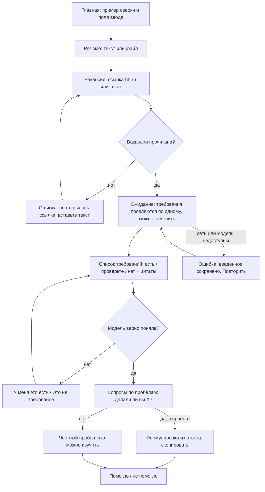

# Бриф ML-продукта: «Сверка»

Черновой бриф по шаблону курса. Название, состав команды и цифры в гипотезах — предложения, их решает команда.

## 1. О проекте

**Название:** Сверка (рабочее)

**Описание:** Сервис сверяет резюме студента с конкретной вакансией на hh.ru. По каждому требованию вакансии он показывает, есть ли его подтверждение в резюме и где именно. Если нет — задаёт вопрос, чтобы вытащить настоящий опыт из учёбы и подработок, а не придумать его.

**Команда:** состав нужно вписать; роли ниже — предложение.

| Участник | Роль | За что отвечает |
| --- | --- | --- |
| (имя) | ML-инженер | извлечение требований, сопоставление, оценка качества |
| (имя) | Fullstack-разработчик | backend, frontend, загрузка вакансии по ссылке |
| (имя) | UX/UI-дизайнер, исследователь | сценарии, макеты, опрос студентов |

## 2. Задача

1. **Задача.** Студент или выпускник откликается на стажировки и junior-вакансии и получает отказы или тишину. Он не понимает, чего именно не хватает, и не умеет подать учебные проекты как опыт. Существующие чекеры дают один балл, который скачет от сервиса к сервису, и советуют вставить ключевые слова.
2. **Решение.** Веб-сервис: резюме + ссылка на вакансию → список требований со статусами и цитатами → уточняющие вопросы по пробелам → предложенные формулировки из ответов. Идеальный результат: за 10 минут студент получает честную картину и резюме, в котором каждую строку может объяснить на собеседовании.
3. **Полезное действие.** Чтобы студенту не нужно было рассылать одно и то же резюме на сотни вакансий и гадать причины отказов.
4. **Критерий успеха.** Доля сверок, после которых студент добавил в резюме хотя бы один подтверждённый пункт из своего опыта. Долгосрочно — доля приглашений на собеседование среди откликов со сверенным резюме (через опрос).

## 3. Аудитория

- Студенты 3–4 курса и выпускники, которые ищут стажировку или первую работу (главный сегмент)
- Студенты младших курсов, ищущие подработку
- Сменщики профессии после курсов без коммерческого опыта в новой сфере

Подробный портрет главного сегмента — в [audience.md](audience.md).

## 4. Job stories

1. Когда я нашёл стажировку на hh.ru, я хочу быстро понять, каких требований не видно в моём резюме, чтобы не отправлять отклик вслепую.
2. Когда в вакансии требуют опыт, которого у меня нет на работе, я хочу понять, подходит ли мой учебный проект, чтобы честно указать его в резюме.
3. Когда сервис говорит, что требования нет в резюме, я хочу видеть, на чём основан вывод, чтобы исправить его, если модель ошиблась.

## 5. ML-часть

| Вопрос | Ответ |
| --- | --- |
| Какую задачу решает модель? | Извлечение списка требований из текста вакансии; классификация пары «требование — резюме» по статусу (есть / частично / нет) с поиском цитаты-доказательства; генерация уточняющих вопросов и формулировок |
| Что пользователь даёт на вход? | Резюме текстом или файлом (PDF/DOCX); ссылку на вакансию hh.ru или её текст; ответы на уточняющие вопросы |
| Что модель возвращает? | Список требований (обязательные / желательные); у каждого статус, цитата из резюме, уверенность и вопрос при пробеле |
| Как результат показывается? | Две колонки: слева требования вакансии с цветными метками, справа резюме; клик по требованию подсвечивает строку-доказательство. Сверху итог словами: «7 из 10 обязательных требований подтверждены», без процентов |
| Что будет, если модель ошибётся? | Назовёт требование закрытым: студент не доработает резюме и получит отказ. Назовёт открытым то, что есть: лишний вопрос, не опасно. Самое опасное — придумать опыт в формулировке: на собеседовании студент не сможет его подтвердить. Поэтому формулировки строятся только из ответов человека |
| Нужно ли показывать уверенность? | Да, на уровне требования и словами: «точное совпадение», «похоже, проверьте», «не нашли». Статус «проверьте» ставится, когда LLM и семантическая близость эмбеддингов расходятся. Общего процента нет сознательно |
| Что делать с плохим результатом? | У каждого статуса кнопки «У меня это есть» (с просьбой указать где) и «Это не требование»; перезапуск сверки после правки резюме; оценка «помогло / не помогло» |
| Сколько ждать? | До 30 секунд (оценка, нужно замерить). Пока ждёт: этапы «Читаю вакансию → Нашла 12 требований → Сверяю с резюме», требования появляются по одному; кнопка «Отменить» |
| Откуда модель? | Готовая LLM по API для извлечения и сопоставления; многоязычная модель эмбеддингов с Hugging Face для независимой проверки. Дальше — данные из кнопок «У меня это есть» для оценки точности. Конкретные модели выбрать по тесту на 20–30 парах «резюме — вакансия» |

## 6. Основной сценарий: сверить резюме с вакансией

## 7. Границы MVP

| Входит в MVP | Не входит |
| --- | --- |
| Резюме текстом и файлом PDF/DOCX | Автоотклики и интеграция с аккаунтом hh.ru |
| Вакансия по ссылке hh.ru и текстом | Генерация резюме с нуля и дизайн-шаблоны |
| Список требований со статусами, цитатами и уверенностью | Сопроводительные письма |
| Уточняющие вопросы и формулировки из ответов | Аккаунты и история сверок |
| Кнопки «У меня это есть», «Это не требование», оценка отчёта | Сторона рекрутера и скрининг кандидатов |
| Пример сверки на пустом экране | Мобильное приложение |

**Ограничения.** Резюме содержит персональные данные: не хранить после сверки, а перед отправкой в API убирать имя, телефон и почту. hh.ru прекратил поддержку API для соискателей, поэтому вакансию по ссылке нужно проверить на правила hh.ru, а запасной путь — вставка текста. Сервис не предсказывает ответ работодателя и должен честно это говорить.

## 8. Конкуренты и референсы

| | [Jobscan](https://www.jobscan.co) | [Enhancv](https://enhancv.com/resources/resume-checker/) | [CV-Help](https://cv-help.ru) | Сверка |
| --- | --- | --- | --- | --- |
| Сверка с конкретной вакансией | ✓ | ✓ (по желанию) | ✓ | ✓ |
| Вакансия по ссылке hh.ru | – | – | ✓ | ✓ |
| Резюме текстом | ✓ | – | – (в форме) | ✓ |
| Результат без регистрации | – | не проверено | ✓ (1 бесплатная) | ✓ |
| Доказательство из резюме у каждого вывода | частично (счётчики) | не проверено | не проверено | ✓ |
| Уверенность модели | – | – | – | ✓ |
| Вопросы вместо напихивания ключевых слов | – | – | – | ✓ |

- **Нравится:** пример отчёта, мастер из 3 шагов и кнопка Add Skill у Jobscan; ссылка на hh.ru и честный тон у CV-Help; обещание не обучать на резюме у Enhancv.
- **Не нравится:** регистрация после ввода и продающие баннеры в отчёте Jobscan; только файл у Enhancv и CV-Help; один балл в центре везде.
- **Главное преимущество:** каждый вывод проверяем по цитате, и мы помогаем честно раскрыть учебный опыт, а не напихать ключевые слова.
- **Референсы:** сравнение документов в две колонки (diff); чек-лист требований как в трекерах задач. Полный разбор конкурентов — в [competitors.md](competitors.md).

## 9. Бренд

- **5 слов:** честный, спокойный, конкретный, доброжелательный, студенческий.
- **Характер:** старшекурсник, который уже прошёл стажировки: «Давай посмотрим, что они реально просят, и что из этого у тебя уже есть».
- **Метафора:** сверка двух списков галочками — как при приёмке товара по накладной. Не экзамен с оценкой.
- **Голос:** интерфейс и модель говорят одинаково: на «ты», коротко, без «Увеличьте шансы на 35%!». Неуверенность говорится прямо: «не уверен, проверь».

## 10. Гипотезы

Целевые значения — стартовые предложения, их нужно согласовать в команде.

1. Если показывать список требований с цитатами вместо балла, то студенты будут больше доверять результату. Проверим так: покажем 10 однокурсникам два макета отчёта по их резюме и спросим «насколько вы доверяете отчёту?» по шкале 1–5.
2. Если задавать вопросы по пробелам, то студенты найдут в своём опыте хотя бы один пункт, которого не было в резюме. Проверим так: считаем долю сверок, где студент скопировал хотя бы одну формулировку из ответа.
3. Если статус «проверьте» ставить при расхождении LLM и эмбеддингов, то большинство нажатий «У меня это есть» придётся на него, а не на «не нашли». Проверим так: прогон на 20–30 размеченных парах «резюме — вакансия».

## 11. Что ещё важно знать

- Сервис не должен помогать приукрашать опыт: hh.ru уже тестирует блокировки за накрутку опыта и планирует сверять его с электронными трудовыми книжками ([Хабр](https://habr.com/ru/post/1012806)).
- Открытый вопрос: какая LLM доступна из России и лучше работает с русскоязычными вакансиями и сколько стоит одна сверка.
